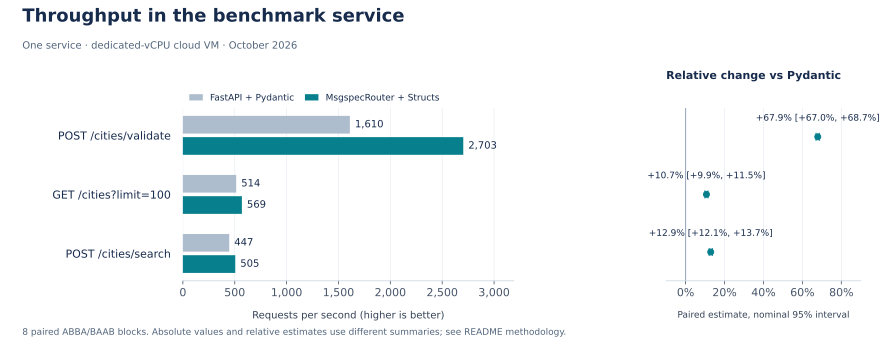
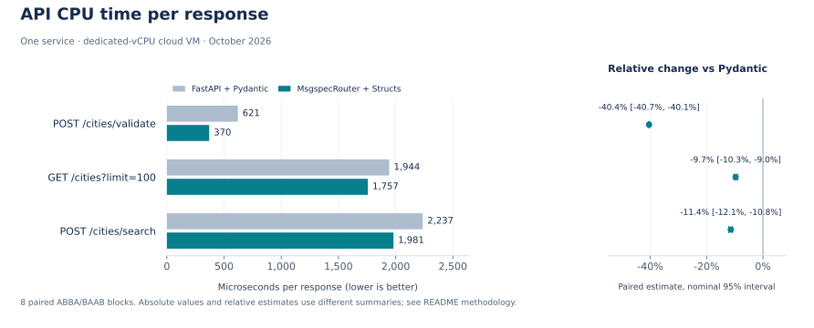

# msgspec-fastapi

An experimental FastAPI router that uses msgspec for JSON request bodies and responses.
In one benchmark service, moving from Pydantic models to msgspec Structs with this router
increased throughput by 68% on a route with a large JSON body and by 11% to 13% on
database-backed routes; see the Benchmarks section below.

This project uses ZeroVer: the major version will always stay at 0. There will be no
1.0 release. The API may change in 0.x releases. The router relies on private FastAPI
internals, so it is pinned to FastAPI 0.142.2 to 0.165.x. It is a personal project,
not part of msgspec; feedback is welcome in the issues.

## Installation

```sh
pip install msgspec-fastapi
```

The package includes an internal C extension for checking copied defaults and
metadata. Building from source requires a C11 compiler and CPython headers.

## Usage

```python
import msgspec
from fastapi import FastAPI
from msgspec_fastapi import MsgspecRouter, install_openapi


class City(msgspec.Struct):
    name: str
    population: int


router = MsgspecRouter()


@router.post('/cities')
async def create_city(city: City) -> City:
    return city


app = FastAPI()
app.include_router(router)
install_openapi(app)
```

## Benchmarks

The router was measured in a small reference-data service on a cloud VM with dedicated
vCPUs (October 2026). Each row compares the same service on FastAPI with Pydantic models
against the same service with msgspec Structs and `MsgspecRouter`. The database queries
(SQLAlchemy ORM), event loop and server settings are the same on both sides, and there
is no cache.

| Request | Requests per second | RPS change | CPU time per response | CPU change |
|---|---|---|---|---|
| `POST /cities/validate`, a JSON body of 100 cities (23 KB), no database | 1,610 → 2,703 | **+67.9%** [+67.0%, +68.7%] | 621 → 370 µs | **-40.4%** [-40.7%, -40.1%] |
| `GET /cities?limit=100`, a page of 100 cities read from PostgreSQL | 514 → 569 | **+10.7%** [+9.9%, +11.5%] | 1,944 → 1,757 µs | **-9.7%** [-10.3%, -9.0%] |
| `POST /cities/search`, small JSON filter bodies, a page of 100 cities | 447 → 505 | **+12.9%** [+12.1%, +13.7%] | 2,237 → 1,981 µs | **-11.4%** [-12.1%, -10.8%] |





The first route returns a constant 16-byte response (`{"accepted":100}`), so the
difference on this route comes mostly from request decoding and validation, and the gain
is largest there. On routes that read from a database, API CPU time per response falls by
about 190 to 260 µs out of roughly 2 ms, so the relative gain is smaller.

In the same service, setting `response_model=None` on the GET route made no detectable
difference in throughput with `MsgspecRouter` (0.0% [-1.0%, +1.0%]). This is consistent
with an instance of exactly the declared Struct class being encoded without
revalidation.

The benchmark sources, the data preparation scripts and the results of all 14
comparisons, including direct asyncpg queries without the ORM, uvloop, a Redis cache,
Litestar and Go, are in
[world-directory-bench](https://github.com/Siyet/world-directory-bench).

<details>
<summary>How it was measured</summary>

- Host: a cloud VM with 6 dedicated vCPUs (AMD EPYC-Rome, KVM), Ubuntu 24.04. The API
  ran as one uvicorn worker (h11, asyncio) pinned to one core; PostgreSQL and the load
  generator ran on other cores.
- Data and database: 224,578 cities, 55,246 division records, 501 country records and
  86,185 airports from GeoNames and OurAirports, about 231 MB in PostgreSQL 18.6
  including indexes. The PostgreSQL data directory was on tmpfs (in memory). Database
  access went through the SQLAlchemy ORM with the asyncpg driver.
- Software: CPython 3.14.7, FastAPI 0.142.2, Pydantic 2.13.5, msgspec 0.22.0,
  SQLAlchemy 2.1.3 (ORM), asyncpg 0.31.0, uvicorn 0.54.0. The router code on the
  measured paths was the same as msgspec-fastapi 0.0.1.
- Load: a Go generator with 20 closed-loop clients, checking every response body. The
  numbers are throughput at saturation of the single API core. The GET mix sends 9 of
  10 requests to one page and every 10th to a page that is not repeated within the run.
- Each comparison is 8 blocks in ABBA or BAAB order, so each block measures both
  versions twice; every run starts a fresh process with a 30 s warmup and a 60 s
  measurement. The percentages are computed from the mean of the per-block log ratios,
  with a nominal 95% t interval over the 8 blocks. The requests per second values are
  the geometric means of each side, and the CPU values are the arithmetic means.
- CPU time per response is the CPU time of the API container in the measurement
  window divided by the number of checked responses. Because the API core was
  saturated, it is close to the inverse of throughput.

</details>

Things to keep in mind:

- On the control side, FastAPI parses the body with `json.loads` and then validates
  it with Pydantic, which is FastAPI's standard path.
- The GET and search rows also include changes outside the router: database rows are
  converted to msgspec Structs instead of Pydantic models and, for GET, the query model is
  msgspec instead of Pydantic, so they measure a migration, not the router alone.
- Both sides check the same constraints, including custom per-record checks written
  in Python. Results for other schemas and other routes will differ.
- This is one series on one machine. The host slowed down near the end of the series: a
  static control was about 10% slower after the series than before it. The blocks of
  all comparisons ran in 8 rounds, and the lasting slowdown began during the last
  round. Leaving out any single round, the last one included, changes each estimate by
  less than 0.32 percentage points. Compare the relative effects rather than the
  absolute numbers.

## What it does

The package uses msgspec for its JSON validation and encoding, without calling Pydantic
validators or serializers. FastAPI still depends on Pydantic for its own internals.

- A msgspec body parameter (a Struct or another type msgspec can decode) is decoded from
  the raw request bytes by a `msgspec.json.Decoder` built once at route registration. A
  body with a non-JSON content type returns 415, malformed JSON or JSON nested too deeply
  returns 400, and a missing or invalid body returns 422. The 415 and 400 responses are
  sent before dependencies run; a 422 is sent after them, as in FastAPI, so a failing
  dependency such as authentication takes precedence. Bodies are decoded in msgspec
  strict mode: for example, the JSON string `"1"` is not accepted for an `int` field,
  unlike FastAPI with Pydantic.
- A body without a content type follows FastAPI's `strict_content_type` setting: it is
  rejected with 415 by default and parsed as JSON when the setting is `False`. FastAPI
  returns 422 in the first case.
- A msgspec response type, from the return annotation or `response_model`, is encoded
  with msgspec. An instance of exactly the declared Struct class is encoded without
  revalidation, as FastAPI does for a Pydantic `response_model`; other values are
  validated against the declared type. Nested values and type parameters of a trusted
  instance are not checked. A NaN or infinite value in a `float` field is encoded as
  `null` unless a constraint rejects it. In a `Decimal` field it is encoded as a string,
  while FastAPI with Pydantic rejects non-finite `Decimal` values.
- With the default `MsgspecJSONResponse`, responses of routes without a return
  annotation or `response_model`, or with `-> None`, are also encoded with msgspec.
  In addition to msgspec's built-in types, `pathlib` paths and standard-library IP
  addresses, interfaces and networks are encoded as strings. Other objects, including
  `BaseModel` instances, `HttpUrl` and `SecretStr`, are unsupported and raise `TypeError`
  during encoding. Values supported directly by msgspec retain its encoding: for example,
  `bytes` are base64-encoded and `Decimal` is encoded as a string.
- Path, query, header and cookie parameters keep FastAPI extraction, aliases and
  defaults, but are converted with `msgspec.convert(strict=False)` instead of Pydantic,
  so coercion differs for some inputs (for example, `" 1.5"` is rejected for `float`
  and `"nan"` is accepted for `Decimal`). Parameter types must be supported by msgspec;
  Pydantic-specific types such as `AnyUrl` raise `TypeError` at route registration.
- On the msgspec validation path, string `pattern` constraints from FastAPI parameters,
  `Body` and supported nested `Field` annotations use Rust's `regex` engine through
  `regexrs-py`, without catastrophic backtracking. Patterns are compiled once at route
  registration. Compiled Python `re.Pattern` objects are rejected rather than falling
  back to a backtracking engine.
  Native `msgspec.Meta(pattern=...)` constraints retain msgspec's Python regex behavior
  and are outside this protection.
- Generator endpoints support JSON Lines with the default response class and SSE with
  `response_class=EventSourceResponse`. Plain yielded items with declared msgspec
  types are validated with the same instance-trust rules as ordinary responses. Untyped
  yielded values are also encoded with msgspec. Explicit instances of the exact
  `ServerSentEvent` class support preformatted `raw_data` and metadata-only events;
  subclasses are unsupported. A non-`None` `data` payload without
  `raw_data` is rejected. For a Struct or Raw payload with event metadata, use
  `ServerSentEvent(raw_data=msgspec.json.encode(payload).decode('utf-8'), id='...')`.
  Explicit `StreamingResponse` keeps raw chunks. Streaming bodies retain dependency
  validation and generator cleanup.
- Custom response classes are supported. Typed response validation and field projection
  happen before response construction. A `JSONResponse` class that does not inherit
  `MsgspecJSONResponse` receives JSON-compatible values converted with msgspec, including
  for untyped returns. Returned `Response` instances pass through unchanged.
- Structural JSON body errors include field names, encoded aliases, keys and indices,
  with multiple errors for supported Structs, regular dataclasses, TypedDicts and
  built-in containers. Diagnostics never repeat model validation hooks or default
  factories: types with hooks or unsupported diagnostic shapes retain the original
  first error. The default 422 handler encodes error details with msgspec; custom
  application exception handlers are preserved. Error details added by dependencies must
  also be encodable by this encoder or handled by a custom exception handler.
- `install_openapi(app)` adds the msgspec JSON schemas to the OpenAPI document. Call it
  once before serving. Routes, webhooks and callbacks are discovered from the application
  when the document is built; the optional router arguments remain accepted for
  compatibility. Hidden routes do not add msgspec components. As in FastAPI, the document
  is cached: set `app.openapi_schema = None` to rebuild it after adding routes.
- Body descriptions and examples, `openapi_extra` request metadata and response examples
  are preserved. JSON body routes document their 400, 415 and 422 responses.
- JSON body and response types must be supported by msgspec. Pydantic models and
  custom Pydantic types are rejected at route registration. Pydantic data objects are
  also rejected before implicit copies of defaults and route metadata.

## Limitations

- Only one msgspec body parameter per route, and it cannot be combined with other
  FastAPI body fields. Only JSON bodies are supported: `application/json`,
  `application/*+json`, or a request without a content type when `strict_content_type`
  is `False`. JSON body parameters in `Depends` functions are not supported; declare
  the JSON body on the route endpoint. `Form()` and `File()` parameters are left to FastAPI.
- On ordinary non-streaming routes, when both the parameters and body are invalid, only
  the parameter errors are returned; FastAPI returns both.
- A custom `route_class` or `route_class_override` must extend `MsgspecRoute`.
- Structs, alone or inside containers, are not supported as path, query, header or
  cookie parameters, or as `Form()` and `File()` parameters.
- Defaults and copied metadata do not support container subclasses, custom state/reduction
  methods, registered copy reducers, dynamic attribute access or custom copy descriptors.
  Ordinary application-defined Python `__deepcopy__` methods and default factories remain
  application code.
- `response_model_include`, `response_model_exclude`, `response_model_exclude_*` and
  `response_model_by_alias=False` are rejected for typed msgspec responses.

## Development

```sh
uv sync --group test --group lint --group typing
uv run --group test pytest
uv run --group lint ruff check .
uv run --group lint ruff format --check .
uv run --group typing mypy src/msgspec_fastapi --follow-imports=silent
uv run --group typing python -m mypy.stubtest msgspec_fastapi._defaults
uv run --group lint pre-commit install
uv run --group lint pre-commit run --all-files
```

After changing C sources, rebuild the extension with
`uv sync --reinstall-package msgspec-fastapi --group test --group lint --group typing`.

Ruff checks imports, annotations and common Python errors, and formats the code.
CI runs the same Ruff version as the pre-commit hooks. Test endpoints that exercise the absence
of a response annotation intentionally omit it.
